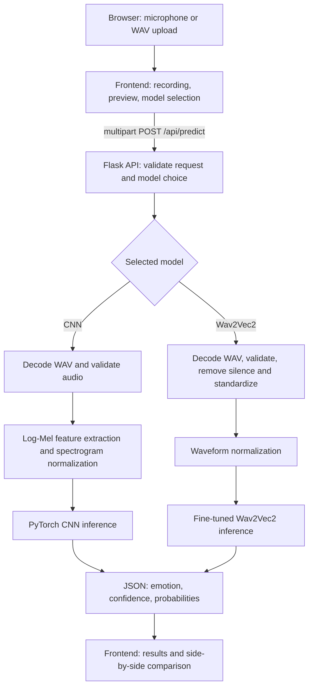

# VoxSense AI — Software Architecture

## Overview

VoxSense AI is a browser-based speech emotion recognition application. It accepts an uploaded WAV file or a recording captured through the browser microphone, sends audio to a Flask API, and returns one of four predicted labels (**neutral, happy, sad, angry**) plus confidence and class scores. The user can select either the CNN or fine-tuned Wav2Vec2 inference path, or compare their outputs using the same recording.

## Component diagram



For comparison mode, the frontend sends the same recording for both model choices; the Flask endpoint processes each request using its selected inference pipeline.

## Components and responsibilities

| Component | Main files | Responsibility |
| --- | --- | --- |
| Browser UI | `frontend/index.html`, `frontend/style.css`, `frontend/script.js` | Recording, WAV upload, preview, waveform, model selection, result rendering and comparison |
| Flask application | `backend/app.py` | Routes, request validation, error responses and inference dispatch |
| Audio preprocessing | `backend/preprocessing.py` | Decode/prepare input, feature extraction and fixed-length audio handling |
| CNN inference | `backend/inference.py`, `ml/model.py`, `ml/dataset.py` | Log-Mel features, spectrogram normalization, cached model loading and prediction |
| Wav2Vec2 inference | `backend/wav2vec2_inference.py` | Waveform preparation, cached fine-tuned model loading and prediction |
| Model download | `scripts/download_models.py` | Retrieve production checkpoints from Hugging Face Hub into the paths expected by the app |
| Automated tests | `tests/`, `tests/e2e/` | Python unit/API and browser tests; local checkpoint-backed tests are separate |
| CI | `.github/workflows/ci.yml` | Run automated tests on GitHub and upload coverage artifacts |

## Main interfaces

- `GET /`: serves the user interface.
- `GET /api/health`: health-check endpoint.
- `POST /api/predict`: expects multipart audio under `audio` and model selector `cnn` or `wav2vec2`; returns emotion, confidence and per-class scores, or an error response.

The production inference functions validate empty, non-finite, and effectively silent recordings. Uploaded audio is limited to 10 MB by the API.

## Model storage and lifecycle

The models are **not committed to GitHub**. `python scripts/download_models.py` fetches the production files from [NeginAbbasabadi/voxsense-ai](https://huggingface.co/NeginAbbasabadi/voxsense-ai):

```text
models/emotion_cnn.pt
models/wav2vec2_finetuned/config.json
models/wav2vec2_finetuned/model.safetensors
```

Inference loaders cache model instances in the running Flask process so checkpoint loading does not happen on every prediction. The CNN loader selects Apple MPS where available, otherwise CPU. The Wav2Vec2 loader likewise selects MPS or CPU.

## Quality assurance and boundaries

GitHub Actions runs fast Python tests and Playwright browser tests, with generated HTML/XML coverage artifacts. The standard CI run does **not** execute checkpoint-backed integration tests or measure real-model prediction quality. These require local model files and the RAVDESS dataset. The published evaluation figures apply to acted RAVDESS speech and should not be interpreted as measurements of a person's true emotional state.
