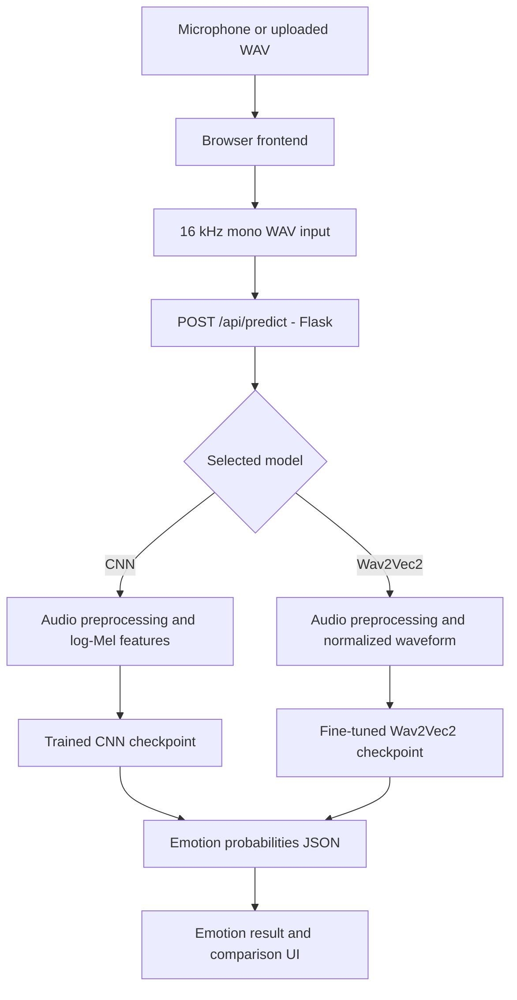

# VoxSense AI — Speech Emotion Recognition

A browser-based speech emotion recognition application developed as a Software Engineering course project. VoxSense AI accepts uploaded WAV recordings or captures speech directly from the microphone, then displays predicted emotion probabilities from either a custom CNN or a fine-tuned Wav2Vec2 model.

> **Research prototype:** Predictions describe patterns learned from acted speech in the RAVDESS dataset. They are not reliable measurements of a person's true emotional state, and confidence scores are not calibrated probabilities of being correct.

## Features

- **Microphone recording:** Start/stop controls, elapsed timer, live waveform, playback, and browser-side conversion to mono 16 kHz PCM WAV.
- **WAV upload:** Upload and preview existing WAV recordings (10 MB maximum).
- **Two inference backends:** Select a CNN baseline or a fine-tuned Wav2Vec2 classifier.
- **Model comparison:** Submit the same recording to both models and compare emotion predictions and class scores side by side.
- **Responsive interface:** Dark-themed interface with animated score bars, visual emotion indicators, and error feedback.
- **Automated verification:** Python unit/API tests, real-model integration tests for local use, Playwright browser tests, and GitHub Actions CI with downloadable coverage reports.

## Technologies

| Area | Technologies |
| --- | --- |
| Frontend | HTML, CSS, vanilla JavaScript, Web Audio API, MediaRecorder |
| API | Python, Flask |
| Audio processing | Librosa, NumPy, SoundFile |
| Machine learning | PyTorch, Hugging Face Transformers, scikit-learn |
| Testing | pytest, pytest-playwright, pytest-cov |
| CI | GitHub Actions |

## Architecture



The four output classes are **neutral**, **happy**, **sad**, and **angry**. The browser sends a multipart form containing the WAV audio and `model=cnn` or `model=wav2vec2`. The API returns the selected model's prediction, confidence score, and probabilities for all four emotions.

### Example API call

With Flask running on port `5002`:

```bash
curl -X POST http://127.0.0.1:5002/api/predict \
  -F 'model=wav2vec2' \
  -F 'audio=@path/to/recording.wav'
```

The response has the following structure (illustrative values):

```json
{
  "emotion": "happy",
  "confidence": 0.85,
  "model": "wav2vec2",
  "probabilities": {
    "neutral": 0.03,
    "happy": 0.85,
    "sad": 0.07,
    "angry": 0.05
  }
}
```

## Installation and setup

### Requirements

- Python 3.13 (the project's development environment); exact platform compatibility depends on the dependency versions.
- A modern browser with microphone support (Chromium is used for automated browser tests).
- Model checkpoints for real emotion prediction. **Model weights are hosted separately on [Hugging Face](https://huggingface.co/NeginAbbasabadi/voxsense-ai); they are not included in the Git repository.**

### Clone and install

```bash
git clone https://github.com/NeginAbbasabadi/Speech-Emotion-Recognition.git
cd Speech-Emotion-Recognition
python3 -m venv .venv
source .venv/bin/activate                 # macOS / Linux
python -m pip install -r requirements.txt
```

To install the additional testing tools:

```bash
python -m pip install -r requirements-dev.txt
python -m playwright install chromium
```

### Download the production model checkpoints

The public [VoxSense AI model repository on Hugging Face](https://huggingface.co/NeginAbbasabadi/voxsense-ai/tree/main) contains the production CNN checkpoint and the fine-tuned Wav2Vec2 checkpoint. After installing `requirements.txt`, run from the project root:

```bash
python scripts/download_models.py
```

This command requires the `huggingface_hub` package to be installed (include it in `requirements.txt`). It downloads the three production model files to the `models/` directory. **The command has been run successfully on the development machine; a completely clean installation and end-to-end prediction have not yet been verified.** A public model repository should not require a Hugging Face access token for downloading.

**Model files:** The application expects these local paths:

```text
models/emotion_cnn.pt
models/wav2vec2_finetuned/config.json
models/wav2vec2_finetuned/model.safetensors
```

The hosted checkpoint folder currently contains `config.json` and `model.safetensors`. If real inference requires additional saved configuration, those files must also be published. Without the model files, the frontend and mocked tests can run, but real predictions cannot. The Wav2Vec2 weights downloaded from Hugging Face have been checked against the local production checkpoint using SHA-256; the hashes matched. The CNN download and a complete fresh-install inference test should still be verified.

### Run the application

```bash
python -m backend.app
```

Open **http://127.0.0.1:5002/** (or the port configured in `backend/app.py`). For microphone capture, allow browser microphone permission. `localhost` is supported by modern browsers for microphone access.

## Machine-learning models and dataset

### Dataset

The project uses four labeled emotion classes from **RAVDESS**. The prepared manifest contains **672 audio recordings**, with **448 training**, **112 validation**, and **112 test** samples. The data were split by actor to separate speakers between partitions. The original RAVDESS WAV files are not committed to this repository.

The project expects the RAVDESS audio under `data/ravdess/` and a manifest at `data/processed/dataset_manifest.csv` for dataset-dependent scripts. Refer to `ml/prepare_dataset.py` for the dataset preparation logic. Dataset-dependent workflows require you to acquire RAVDESS separately and preserve the expected directory layout.

### CNN baseline

The original classifier processes audio into **64-band log-Mel spectrograms** and passes them through a convolutional neural network. See `ml/model.py`, `ml/train.py`, `ml/evaluate.py`, and `backend/inference.py`.

### Wav2Vec2

A second classifier starts from `facebook/wav2vec2-base`. Experiments include a frozen-encoder baseline and a fine-tuned version with the final two encoder layers unfrozen. The inference pipeline processes a normalized waveform rather than a log-Mel spectrogram. See `ml/pretrained/` and `backend/wav2vec2_inference.py`.

### Recorded test-set results

The previously obtained RAVDESS test-set evaluation results are:

| Metric | CNN baseline | Fine-tuned Wav2Vec2 |
| --- | ---: | ---: |
| Accuracy | 50.89% | 79.46% |
| Macro F1 | 48.72% | 78.08% |

These figures describe this project's RAVDESS evaluation, **not** performance guarantees on spontaneous speech or other recording conditions. The test data were examined during development, so these results should not be described as a completely untouched final benchmark. Additional experiment histories and reports are in `results/`.

## Automated testing

Tests cover individual audio/model components, Flask request handling, browser interactions, and checkpoint-backed inference.

| Test category | Purpose | Checkpoints needed? |
| --- | --- | --- |
| Unit tests | Audio preprocessing, augmentation, CNN structure, inference validation | No |
| API tests | Request validation, model selection, JSON responses, errors | No (inference mocked) |
| E2E browser tests | Upload, model selection, comparison, simulated microphone | No (prediction responses mocked) |
| Real-model integration tests | Load checkpoints and process real RAVDESS WAV files | **Yes** |

Run the fast Python suite:

```bash
python -m pytest tests/ -v \
  --ignore=tests/e2e \
  --ignore=tests/test_model_inference.py
```

Run end-to-end browser tests while Flask is running on port 5002:

```bash
python -m pytest tests/e2e/ -v
```

Run real-model integration tests locally, after obtaining checkpoints and data:

```bash
python -m pytest tests/test_model_inference.py -v
```
### Code Coverage

VoxSense AI uses `pytest-cov` to measure Python statement and branch coverage during automated testing.

The coverage reports are generated automatically by GitHub Actions and uploaded as downloadable artifacts.

#### Initial Coverage Results

| Component | Coverage |
|---|---:|
| Flask API | 90% |
| Audio preprocessing | 80% |
| Audio augmentation | 76% |
| CNN architecture | 61% |
| Wav2Vec2 inference | 36% |
| CNN dataset | 31% |
| CNN inference | 25% |
| **Overall project** | **31%** |

These figures represent the initial combined statement and branch coverage, not the percentage of tests passed.

The overall percentage is affected by training and evaluation scripts that are not executed during standard CI testing. Real-model inference tests are also excluded from the standard workflow because they require locally stored model checkpoints and audio data.

#### Viewing the Full Coverage Report

1. Open the repository's **Actions** tab.
2. Select a successful CI workflow run.
3. Download the `python-coverage-report` artifact.
4. Extract the ZIP archive.
5. Open `htmlcov/index.html` in a browser.

Coverage reports are regenerated whenever the CI workflow runs.

### Coverage reports

Generate full-project Python coverage for the fast test suite:

```bash
python -m pytest tests/ \
  --ignore=tests/e2e \
  --ignore=tests/test_model_inference.py \
  --cov=backend --cov=ml --cov-branch \
  --cov-report=term-missing \
  --cov-report=html:htmlcov \
  --cov-report=xml:coverage.xml
```

Open `htmlcov/index.html` to explore missed lines. A baseline report generated on **10 November 2026** measured **31% combined statement/branch coverage** across `backend` and `ml`. This includes training and evaluation scripts that the fast tests intentionally do not execute; it is **not** a measure of model accuracy or overall software correctness. New inference tests may change that percentage.

### Continuous integration

The workflow at `.github/workflows/ci.yml` runs on pushes and pull requests targeting `main`. It installs Python dependencies, runs fast pytest tests with coverage, launches Flask, and executes Playwright tests in Chromium. It uploads HTML/XML coverage artifacts to the workflow run. Real-model integration tests are intentionally excluded because the GitHub runner does not have the model checkpoints or the RAVDESS dataset.

## Repository layout

```text
backend/                 Flask API, preprocessing and inference
frontend/                HTML, CSS and JavaScript UI
ml/                      CNN architecture, data prep, training, evaluation
ml/pretrained/           Wav2Vec2 training and evaluation
models/                  Downloaded checkpoints (not committed)
data/ravdess/             Local source recordings (not committed)
data/processed/           Dataset split manifest
results/                  Experiment histories and evaluation reports
tests/                    Unit, API and integration tests
tests/e2e/                Playwright browser tests
scripts/download_models.py Download production checkpoints from Hugging Face
.github/workflows/       CI configuration
requirements.txt         Application / ML dependencies
requirements-dev.txt     Additional testing dependencies
```

## Limitations and future work

- **Domain shift:** Acted RAVDESS speech differs from natural conversations, microphone recordings, languages, accents, and recording conditions.
- **Short input window:** Both inference pipelines standardize audio to approximately three seconds; longer recordings may be cropped.
- **Emotion interpretation:** The model estimates one of four learned labels, not a speaker's internal emotional state. Softmax confidence is not calibrated.
- **Checkpoint distribution:** Production checkpoints are hosted publicly on Hugging Face and can be retrieved by `scripts/download_models.py`. A complete clean-install verification, including an actual inference request, is still pending.
- **CI scope:** Standard CI uses mocked predictions and doesn't assess trained-model accuracy. Local integration/evaluation workflows handle model-backed checks.
- **Future improvements:** Better real-world data evaluation, confidence calibration, accessibility testing, deployment, and automated clean-install validation.

## Project status

Course prototype with a working browser interface, CNN and Wav2Vec2 inference paths, automated tests, and GitHub Actions CI. The production checkpoints are publicly hosted on Hugging Face and have a download script; complete fresh-clone reproducibility remains to be tested.
